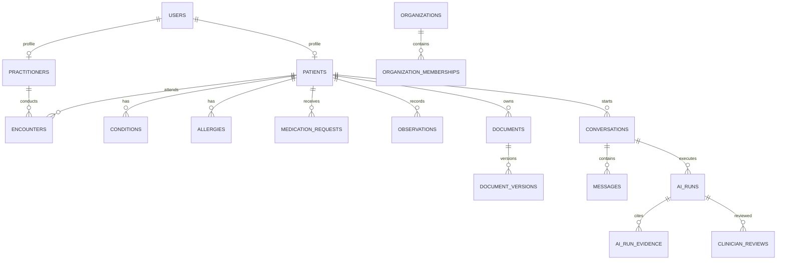

# SmartDoctor Data Model and FHIR Mapping

## 1. Principles

- PostgreSQL is the transactional source of truth for SmartDoctor-owned records.
- A connected EHR remains authoritative for data originating in that EHR unless a contract says otherwise.
- Preserve original source identifiers, organization, timestamps, status, version and provenance.
- Patient-reported facts must not be silently converted into clinician-confirmed conditions.
- Keep original documents immutable; store extraction results as versioned derivatives.
- Use UUIDs internally and stable external identifiers for partner mappings.
- Apply tenant and patient scope to every clinical resource.

## 2. Domain areas and proposed entities

### Identity and tenancy
| Entity | Key fields |
|---|---|
| users | id, subject_id, email/phone reference, status, created_at |
| roles | id, role_code, description |
| user_roles | user_id, role_id, organization_id |
| organizations | id, name, type, status |
| organization_memberships | organization_id, user_id, role_id, status |
| patients | id, user_id, patient_number, demographics reference |
| practitioners | id, user_id, registration identifier, specialty |
| practitioner_patient_access | practitioner_id, patient_id, organization_id, scope, valid_from, valid_to |
| consents | id, patient_id, purpose, recipient, status, effective period, source |

### Clinical records
| Entity | Key fields |
|---|---|
| encounters | id, patient_id, practitioner_id, organization_id, period, status |
| conditions | id, patient_id, code_system, code, display, clinical_status, verification_status |
| allergies | id, patient_id, substance, reaction, severity, verification_status |
| medication_requests | id, patient_id, requester_id, medication_code, dosage, status |
| medication_statements | id, patient_id, medication_code, effective_period, status, source |
| observations | id, patient_id, encounter_id, code, value, unit, effective_at, interpretation |
| procedures | id, patient_id, code, performed_at, status |
| diagnoses | id, patient_id, encounter_id, code, recorder_id, status |
| care_plans | id, patient_id, author_id, status, period |

### Documents and reports
| Entity | Key fields |
|---|---|
| documents | id, patient_id, organization_id, document_type, storage_key, checksum, source, status |
| document_versions | id, document_id, version, storage_key, checksum, created_at |
| extraction_runs | id, document_version_id, model_version, status, confidence, output_reference |
| diagnostic_reports | id, patient_id, document_id, report_code, issued_at, performer |
| diagnostic_report_results | id, report_id, observation_id, source_location |
| reference_ranges | id, observation_id, low, high, unit, applicability, source |

### Conversations and AI governance
| Entity | Key fields |
|---|---|
| conversations | id, patient_id, created_by, language, status, created_at |
| messages | id, conversation_id, sender_type, content_reference, created_at |
| conversation_summaries | id, conversation_id, version, summary_reference, created_at |
| symptom_assessments | id, patient_id, conversation_id, status, source |
| symptom_items | id, assessment_id, symptom_code, display, onset, duration, severity |
| ai_runs | id, conversation_id, workflow, model_id, model_version, prompt_version, status |
| ai_run_evidence | id, ai_run_id, source_id, chunk_id, citation_metadata |
| ai_outputs | id, ai_run_id, output_type, output_reference, validation_status |
| clinician_reviews | id, ai_run_id, practitioner_id, decision, reviewed_at, note_reference |
| audit_events | id, actor_id, action, resource_type, resource_id, purpose, timestamp, correlation_id |

## 3. Relationship overview

## 4. FHIR mapping

Target interoperability baseline: FHIR R4, subject to the partner's implementation guide and version.

| Internal concept | FHIR resource |
|---|---|
| Patient | Patient |
| Practitioner | Practitioner |
| Organization | Organization |
| Encounter | Encounter |
| Condition | Condition |
| Allergy | AllergyIntolerance |
| Observation / vital sign | Observation |
| Medication request | MedicationRequest |
| Medication history statement | MedicationStatement |
| Diagnostic report | DiagnosticReport |
| Uploaded report reference | DocumentReference |
| Procedure | Procedure |
| Consent | Consent |
| Care plan | CarePlan |
| Appointment | Appointment |

Do not assume all partners support every resource, search parameter or profile. Validate CapabilityStatement and implementation-guide constraints during integration onboarding.

## 5. Terminology

Where appropriate and licensed, use:
- SNOMED CT for clinical concepts.
- LOINC for observations and laboratory tests.
- ICD-10 or jurisdictional diagnosis classifications for reporting.
- RxNorm or jurisdiction-specific drug terminology for medication identity.
- UCUM for units.

Preserve original display text and source coding even when a normalized code is added. Do not invent codes.

## 6. Lab result representation

A result should preserve:
- Test code/system and display.
- Exact source value and comparator.
- Original unit and normalized unit, if conversion is validated.
- Reference range and applicable population/condition.
- Interpretation supplied by the lab.
- Specimen, method and effective/issued timestamps when available.
- Source document, page/region and extraction confidence.
- Verification status and reviewer.

Never replace missing lab-specific reference ranges with a generic range without explicitly identifying the source and applicability.

## 7. Provenance and verification

Every clinical fact should carry a source category such as patient-reported, clinician-entered, imported-from-EHR, lab-reported or AI-extracted. Track recorded time separately from clinical effective time. Track author/performer, source system, verification status and version.

## 8. Storage and indexing

- Encrypt original files in object storage.
- Store file metadata and access policy in PostgreSQL.
- Store derived text/chunks in a separate retrieval index with tenant_id, patient_id where applicable, document_id, version, source and ACL metadata.
- Re-check authorization in the application before returning vector search results. Vector metadata filters are defense-in-depth, not the authorization boundary.
- Support index deletion/rebuild when a source document is removed or access is revoked, subject to legal retention requirements.

## 9. Database implementation notes

Use migrations, foreign keys, unique constraints and transaction boundaries. Apply row-level security where suitable as an additional control. Avoid putting all clinical content into a single JSON column; use JSONB for versioned extraction payloads or partner-specific extensions while keeping core queryable facts normalized.
