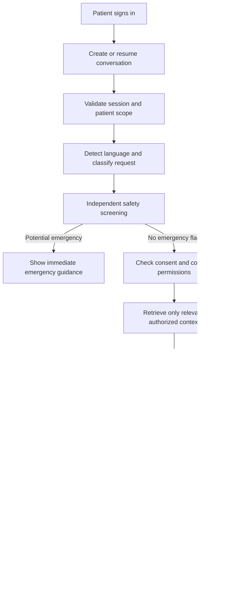
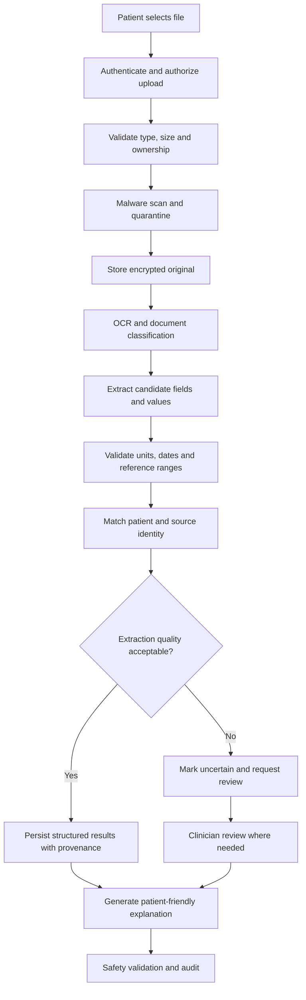
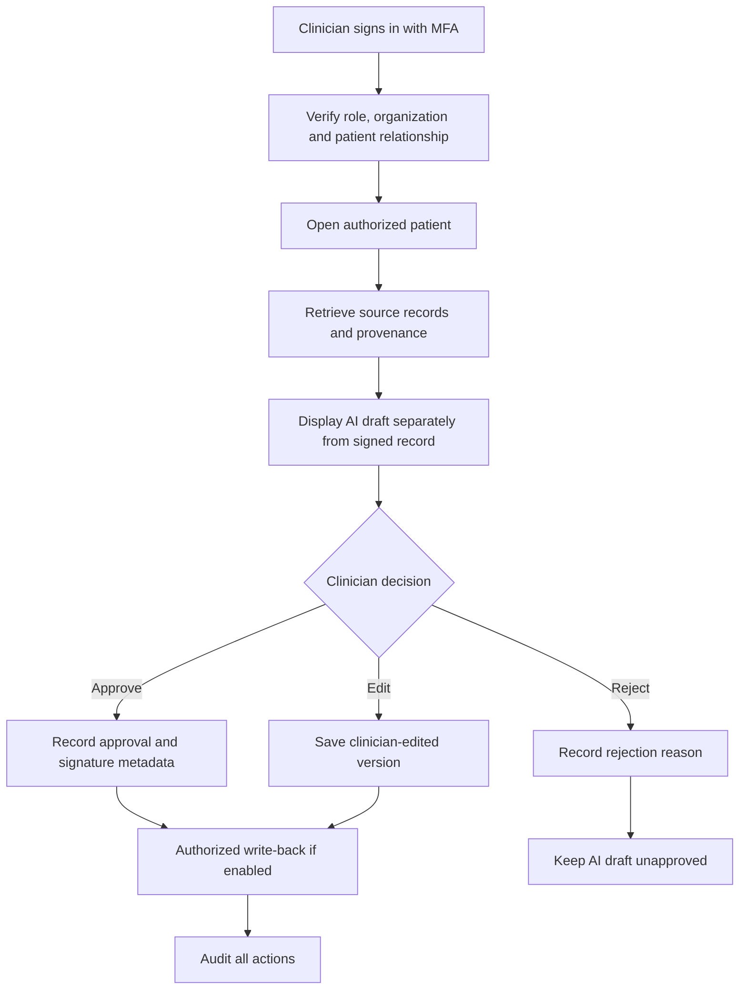

# SmartDoctor Workflows

This document describes the end-to-end user and system flows. Each workflow must enforce authorization, consent, provenance, safety checks and audit logging.

## 1. Patient asks a health-information question

Rules:
- The server derives patient identity from the authenticated principal, never from an untrusted request field.
- Missing records are not interpreted as negative history.
- The system distinguishes patient-reported facts, imported records and clinician-confirmed facts.
- If evidence is unavailable or contradictory, say so and recommend an appropriate professional.
- Emergency messaging must not wait for normal RAG or model completion.

## 2. Patient-provided document workflow

Controls:
- Preserve the original file and checksum.
- Never silently overwrite the original or previously verified result.
- Store extraction confidence and field-level source location where possible.
- Do not infer a reference range when the report does not supply one.
- Critical-looking results require a defined, clinically approved escalation policy; the LLM alone must not determine urgency.
- Patient identity mismatch or unreadable values must stop automatic interpretation.

## 3. Direct EHR/FHIR retrieval workflow

1. Patient identity is verified using the partner-approved identity-linking process.
2. The patient is shown the relevant consent and purpose.
3. The integration adapter obtains a scoped token using the partner's supported authorization flow.
4. The adapter fetches only required resources.
5. Resources are validated against the negotiated FHIR version and implementation guide.
6. External identifiers, source organization, timestamps, status and version are preserved.
7. Data is normalized into internal domain models without losing the source representation/reference.
8. Synchronization state and errors are recorded.
9. The AI context builder selects only relevant, authorized resources for a specific request.
10. The system clearly labels imported data and freshness.

Never use a patient name alone as a safe matching key. Use verified identifiers and explicit reconciliation for ambiguous matches. Avoid duplicate creation on retries; use idempotency keys and external resource versioning.

## 4. Clinician review workflow

- AI drafts are visibly marked as generated and unverified.
- Only appropriately credentialed clinicians may sign clinical content.
- The clinician must be able to inspect the original source records and evidence.
- Approval does not imply that every downstream EHR write succeeded; show integration status.
- Do not let an AI agent sign, approve or independently write clinical decisions.

## 5. Symptom assessment workflow

1. Classify the user's intent as symptom-related.
2. Run independent emergency warning-sign checks.
3. If potential emergency is detected, provide immediate location-appropriate emergency guidance and stop routine questioning.
4. Otherwise collect a minimal, relevant set of patient-reported facts: symptom, onset, duration, severity, progression and associated symptoms.
5. Ask one focused clarification at a time when essential information is missing.
6. Retrieve relevant patient context only with authorization.
7. Provide general information and a safe next step; do not state a definitive diagnosis.
8. Recommend clinician assessment when indicated by an approved protocol.
9. Save the assessment as patient-reported, not as a diagnosis.

## 6. Medication information workflow

- Resolve the medication identity using a trusted drug terminology/catalogue.
- Distinguish a medication request, prescription, medication statement and administration.
- Check relevant allergies and available medication context.
- Retrieve current, jurisdiction-appropriate product information.
- Explain only what the source supports.
- Do not start, stop, substitute or change dose/frequency.
- Route suspected interaction, overdose, adverse reaction or urgent concern to an approved clinical/emergency pathway.

## 7. Doctor handoff workflow

Create a concise, source-linked summary containing the patient's stated concern, symptom timeline, relevant verified records, current medications, allergies, report references, unresolved questions and safety flags. Label each item by source and date. Assign only to an authorized clinical queue. The receiving clinician reviews and records the decision.

## 8. Conversation continuity

Persist message events and a versioned summary. Retrieve only the minimum relevant history. Summaries must not convert uncertain patient statements into confirmed diagnoses. A user correction should supersede the prior patient-reported statement while retaining an audit trail. Do not place raw PHI in cache keys or logs.

## 9. Failure and fallback behavior

| Failure | Expected behavior |
|---|---|
| LLM unavailable | Explain limitation; preserve conversation; offer non-AI routes |
| Local model timeout | Use approved fallback only if data policy permits |
| Cloud provider unavailable | Do not bypass privacy rules; use local approved path or safe fallback |
| EHR unavailable | Show last successful sync time and mark data stale |
| OCR uncertain | Mark fields uncertain; request better upload or human review |
| Patient match ambiguous | Stop data display and require reconciliation |
| Qdrant unavailable | Use approved non-vector fallback or state evidence unavailable |
| Emergency rules service unavailable | Fail safe with generic emergency instructions when urgent symptoms are reported |
| Consent revoked | Stop future processing under that consent and apply retention/legal policy |

## 10. Workflow audit events

Record actor, patient/resource scope, purpose, action, timestamp, correlation ID, source system, outcome and relevant version identifiers. Keep sensitive payloads out of audit metadata; use protected references instead.
